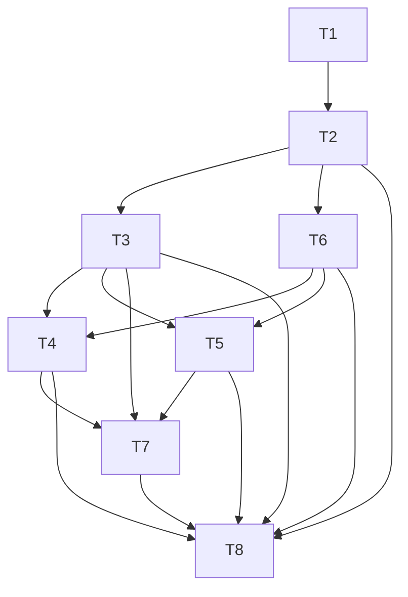

# 装修记录网站 · 研发任务拆解

> 版本：v0.1（草案）  |  日期：2026-08-18  |  状态：研发跟进用
> 关联文档：`产品需求文档(PRD).md`、`技术设计文档.md`、`研发评审材料.md`
> 范围：**MVP（P0）**；议题已按 `研发评审材料.md §8` 确认

---

## 1. 拆解说明

将 MVP 拆为 8 个研发任务（T1–T8），每个含子任务与依赖。任务按「后端接口 → 前端页面 → 联调」组织，优先打通核心闭环（账户→项目→花销→概览）。

---

## 2. 任务清单（P0）

### T1 工程骨架搭建
- 后端：Spring Boot 4 + Maven 初始化；引入 **Springdoc OpenAPI**（自动接口文档）；按 `技术设计文档.md §4` 建模块（auth/project/phase/expense/attachment/todo/dashboard）；`docker-compose.yml` 拉起 PG+Redis；Flyway `V1__init.sql` 建表（见 `研发评审材料.md §4`）；**所有组件（含数据库操作、接口文档、JSON/JWT/缓存等）确保 Native 兼容**——反射/代理用 `@RegisterReflection`/`RuntimeHints` 声明，先 JVM 跑通、生产前打 native 镜像验证。
- 前端：Next.js（App Router + TS）初始化（**pnpm** 管理依赖）；`app/`、`components/`、`lib/` 目录；路由骨架与移动优先布局。
- Native：`pom.xml` 加 native profile（**先以 JVM 跑通，上线前再打 native 镜像**）。
- **依赖**：无 ｜ **前置**：技术设计文档

### T2 账户体系
- 后端：`/api/auth/register|login|logout`；JWT 签发/校验（2h，无 refresh）；bcrypt 哈希；统一响应与异常（`code` 规范见 §4）。
- 前端：登录/注册页；token 存 localStorage；路由守卫（401 跳登录）。
- **依赖**：T1

### T3 项目/房屋档案
- 后端：`/api/projects` CRUD；**新建项目自动初始化 8 标准阶段**（sort_order 定序、budget 默认 0）；按 `user_id` 强隔离。
- 前端：项目列表/首页（卡片+进度条+空态）；新建/编辑项目页（预算>0 校验）。
- **依赖**：T2

### T4 阶段时间线
- 后端：`/api/projects/{id}/phases` 查询/更新（status/起止日期/budget/note）；阶段照片通过 attachments 关联。
- 前端：时间线页（竖向时间轴、三态切换、设阶段预算、传图、备注）。
- **依赖**：T3、T6（图片）

### T5 花销记账
- 后端：`/api/projects/{id}/expenses` CRUD + 筛选（phaseId/category/分页 size=20）；金额 `NUMERIC(14,2)`、>0 校验；可关联图片 URL。
- 前端：记账页（金额/分类下拉/阶段下拉/支付方式/日期/备注/传图）；花销列表（筛选、编辑、删除二次确认）。
- **依赖**：T3、T6（图片）

### T6 图片上传（imgbb）
- 后端：`/api/attachment/upload-key` 返回会话级 Key（前端 24h 缓存不复请）；`/attachments` 保存 URL 关联（多态 ref_type/ref_id）。
- 前端：图片上传组件——**压缩（最长边 1920、质量 0.8）→ 取 Key → 直传 imgbb → 回传 URL**；失败降级"仅存文字"。
- **依赖**：T2

### T7 概览仪表盘
- 后端：`/api/projects/{id}/dashboard` 聚合——总预算、已花、剩余、是否超支及超出额、各阶段预算 vs 实际（超支标记）、分类占比、完成度；结果缓存 Redis（1~5 分钟，写花销后失效）。
- 前端：概览页（预算卡+超支红字、分类环形图、各阶段对比条、完成度；空态引导）。
- **依赖**：T3、T4、T5

### T8 非功能与联调
- 统一异常处理/401/JWT 校验/输入校验；移动端适配与交互打磨；基础埋点（注册、新建项目、记花销、阶段变更、图片上传、打开概览，见 PRD §8）；冒烟联调。
- **依赖**：T2–T7

---

## 3. 依赖关系

关键路径：**T1 → T2 → T3 →（T4/T5 + T6）→ T7 → T8**。

---

## 4. 里程碑建议

| 里程碑 | 范围 | 出口标准 |
| --- | --- | --- |
| M1 骨架+账户 | T1、T2 | 能注册登录，本地 PG+Redis 起得来，Flyway 建表成功 |
| M2 核心数据 | T3、T4、T5 | 能建项目（自动 8 阶段）、推进阶段、记花销并归属阶段 |
| M3 图片+概览 | T6、T7 | 图片压缩直传可用；概览展示预算/已花/超支/阶段对比 |
| M4 联调+打磨 | T8 | 全链路联调通过，移动端适配，埋点上报，冒烟无阻塞 |

> 排期与资源（谁开发、何时上线）需技术负责人确认，本材料不拍板排期。

---

## 5. 风险与阻塞（延续评审材料）

- **Native 反射**：JPA 实体/Jackson DTO/JWT 类需 `@RegisterReflection`；先 JVM 跑通再切 native，降低踩坑成本。
- **imgbb 额度**：监控上传成功率，不足时平滑换 MinIO/COS（接口/前端调用不变）。
- **图片压缩兼容**：统一处理 EXIF 旋转，压缩失败回退原图。
- **金额精度**：全程 `NUMERIC(14,2)`，禁用浮点。

---

## 6. 下一步

- 将 T1–T8 **拆为子事项**分配给对应开发，并附上 PRD + 技术设计 + 研发评审三份文档。
- 进入**阶段五：测试验收**——基于 PRD 生成测试用例、边界/异常场景与验收清单。

### 阶段流转提醒
- 研发任务建议创建为事项，给开发同学分配并添加关注人。
- 重要文档（PRD/技术设计/研发评审/本拆解）上传到项目资料库，形成统一上下文。

---

## 7. 实施进度（2026-08-18）

已完成初版代码骨架，目录结构见 `项目说明.md`：

- **后端 `server/`**：落地 T1–T7 全部接口（auth / project / phase / expense / attachment / overview）。含 Flyway `V1__init.sql` 建表、JWT（2h 无刷新）、统一返回 `ApiResult` 与全局异常处理、Springdoc OpenAPI 自动文档、全量 `@RegisterReflectionForBinding` 以兼容 Native。Native 构建 profile 见 `pom.xml`。
  - 注：概览接口实现为 `GET /api/projects/{id}/overview`，与本文 §T7 草案的 `/dashboard` 命名不同，**以代码为准**。
  - 注：`/api/auth/logout` 未单独实现，前端清除 localStorage token 即登出。
- **前端 `web/`**：落地登录/注册、项目列表、新建项目、项目详情（时间线 / 记账 / 概览 三 Tab）、图片上传组件（Canvas 压缩 1920@0.8 → 取 Key → imgbb 直传 → 回传 URL）。pnpm 管理，Next rewrites 代理 `/api` 到后端 8080。
- **`miniprogram/`**：仅占位，见 `miniprogram/小程序占位说明.md`。
- **`docker-compose.yml`**：本地一键拉起 PostgreSQL 16 + Redis 7。

**待完成**：T8 联调打磨（埋点细化、移动端交互打磨）、Native 编译实测验证、小程序开发。

**运行方式**：详见 `项目说明.md`（本机 Java 经 jenv 管理，项目固定 jdk 25（graalvm））。
