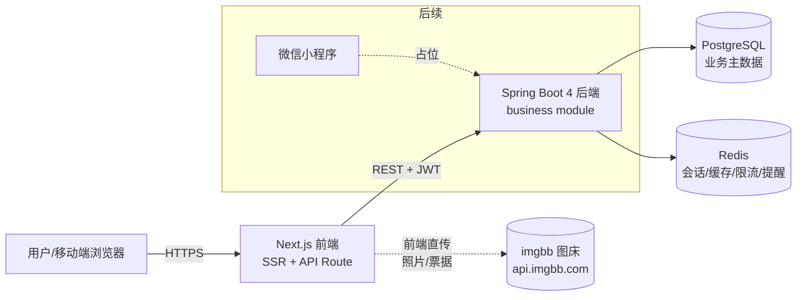
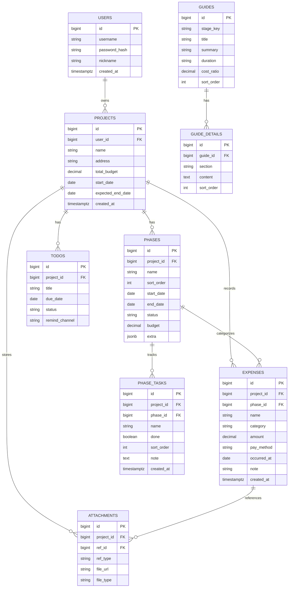

# 装修记录网站 · 技术设计文档

> 版本：v0.3（草案）  |  日期：2026-08-18  |  状态：技术栈已确认，阶段可自定义 + 阶段内子项 + 花销物品名 + 装修指南解绑，待评审
> 适用范围：需求规划阶段确认后的技术落地方案（阶段三：设计与研发评审前的基础技术决策）

---

## 1. 技术栈总览

| 层 | 技术 | 说明 |
| --- | --- | --- |
| 前端 | **Next.js**（App Router + TypeScript） | 移动优先的响应式 Web，支持 SSR/SSG，后续可与小程序共享部分业务逻辑 |
| 后端 | **Spring Boot 4**（Java 25（graalvm，jenv 管理），Maven，GraalVM Native Image） | 单体应用起步；Maven 构建；**全量兼容 Native Image**；接口文档用 **Springdoc OpenAPI** 自动生成 |
| 关系数据库 | **PostgreSQL** | 业务主数据（用户、项目、阶段、花销、资料、待办），关系强、支持 JSONB 存灵活字段 |
| 缓存 | **Redis** | 会话/Token、热点统计缓存、接口限流、待办提醒队列 |
| 图片存储 | **imgbb 图床**（api.imgbb.com） | 前端持后端下发的 API Key 直传图片，拿到 URL 回传后端入库；服务器不落原图 |
| 小程序 | 微信小程序（**占位，先不开发**） | 仅保留目录与接口预留，后续阶段再落地 |
| 部署 | Docker + GraalVM Native Image | 容器化交付，本地开发用 docker-compose 拉起 PG/Redis |

> **本地 Java 环境（jenv）**：本机用 jenv 管理多版本 JDK，已注册 `1.8` / `17` / `25`；本项目固定使用 **jdk 25（`graalvm64-25`，自带 Native Image）**。仓库根目录与 `server/` 已放置 `.java-version=25`，进入目录自动切换；编译级别按 Spring Boot 4 要求设为 21（JDK 25 向下兼容）。详细构建/运行步骤见 `项目说明.md`。

---

## 2. 系统架构



要点：
- **移动优先**：装修记录大量在工地现场拍照，前端以移动端体验为核心，响应式适配桌面。
- **前后端分离**：Next.js 负责页面与轻量 BFF（API Route 可做鉴权转发/聚合），重业务逻辑下沉到 Spring Boot。
- **Native 编译（直接启用）**：以 GraalVM Native Image 为构建目标（Maven `native` profile 一键构建）。开发期仍可用 JVM 模式快速启动/热更；CI 与生产镜像统一打 native executable，启动秒级、内存更低、云原生友好。注意 Spring 反射/动态代理需配 `@RegisterReflection` 等提示。
- **图片走图床**：照片/票据由前端持后端下发的 imgbb API Key 直传 `api.imgbb.com`，仅把返回的图片 URL 存库，服务器不落原图、数据库不存二进制，避免 PG 膨胀与出口带宽压力。
- **攻略内容公开可读（已解绑）**：装修指南为公开内容（未登录可看），由后端 `guides` 表提供、前端 SSR 渲染，不依赖用户态；**v0.3 起其阶段 `stage_key` 不再绑定用户实际自定义的阶段**，攻略仅作 8 标准阶段的通用科普参考，用户看完自行对应到自己的阶段，避免强行匹配带来的困惑。

---

## 3. 技术选型理由

- **Next.js**：SSR 利于首屏与 SEO（后续若做"装修攻略"类公开页有价值）；React 生态成熟，组件化适合做仪表盘、时间线等复杂交互；App Router 的 Server Component 可减少前后端扯皮。
- **pnpm**：前端依赖统一用 **pnpm** 管理（安装快、省磁盘、依赖严格隔离），替代 npm/yarn；`web/` 项目以 `pnpm install` / `pnpm dev` 为标准命令。
- **Spring Boot 4 + Native**：约定优于配置、生态完善（Spring Security/JPA/Validation 开箱即用）；Native Image 让单实例在容器/K8s 下更省资源；为"后续开放注册、多用户"提前铺好账户与权限底座。
- **PostgreSQL**：装修数据结构关系明确（项目→阶段→花销→资料），强一致与事务可靠；`JSONB` 可存阶段自定义字段、扩展属性，无需频繁改表。
- **Redis**：登录态/Token 集中管理便于多端统一登出；概览仪表盘的汇总统计可缓存；待办提醒用 Redis 过期事件或延迟队列实现轻量提醒。
- **imgbb 图床**：零自建存储成本，前端直传减轻后端带宽；前端上传前先压缩以控体积；后端只管 Key 下发与 URL 持久化，职责清晰，便于后续多用户横向扩展。
- **Springdoc OpenAPI**：基于代码注解自动生成 OpenAPI/Swagger 接口文档，与 Spring Boot 4 适配且**支持 Native Image**（自带反射提示，免去手工维护接口文档）；文档地址 `/swagger-ui.html`、`/v3/api-docs`。
- **Native 全量兼容约束**：所有组件（JSON 序列化、JWT、Bean Validation、Springdoc、Redis 序列化、JPA/Flyway 数据库操作等）均须可在 GraalVM Native Image 下运行；凡涉及反射/动态代理/资源加载的，必须用 `@RegisterReflection` 或 `RuntimeHints` 显式声明；开发期用 JVM 跑通，CI/生产以 native 镜像验证。

---

## 4. 项目结构（约定）

```
zhuangxiu/
├── docs/                      # 需求/设计/接口文档（本目录）
│   └── 技术设计文档.md
├── web/                       # 前端 Next.js 项目
│   ├── app/                   # App Router 页面与路由
│   ├── components/            # 通用组件（时间线/记账卡片/仪表盘）
│   ├── lib/                   # API 客户端、工具
│   └── public/
├── server/                    # 后端 Spring Boot 4 项目
│   ├── pom.xml                # Maven 构建（含 native 构建 profile）
│   └── src/main/java/com/biliww/zhuangxiu/
│       ├── config/            # 安全、Redis、JPA、Native 配置
│       ├── module/
│       │   ├── auth/          # 注册/登录/JWT
│       │   ├── project/       # 项目/房屋档案
│       │   ├── phase/         # 阶段时间线
│       │   ├── expense/       # 花销记账
│       │   ├── attachment/    # 资料/票据
│       │   ├── todo/          # 待办/提醒
│       │   ├─── guide/         # 装修指南（公开内容，8 标准阶段攻略）
│       │   └── dashboard/     # 概览统计
│       ├── common/            # 统一响应、异常、分页
│       └── Application.java
│   └── src/main/resources/
│       ├── application.yml
│       └── db/migration/      # Flyway 版本化 SQL 脚本（自动建表/升级）
├── miniprogram/               # 微信小程序（占位，先不开发）
│   └── README.md              # 说明：预留，接口与后端复用
└── docker-compose.yml         # 本地 PG + Redis 一键拉起
```

---

## 5. 数据库设计（初步 ER）

核心实体与关系（MVP 范围）：



说明：
- 阶段（PHASES）`sort_order` 用于排序；**v0.3 起阶段可由用户自定义**（默认套 8 标准阶段模板，可增删改阶段、改阶段名、拖拽排序），`status` 表示未开始/进行中/已完成；`budget` 为该阶段预算；`jsonb extra` 预留扩展。
- 花销（EXPENSES）通过 `phase_id` 归属阶段，`name` 为物品/器材名称（必填，与 `category` 区分），`category` 为设计费/材料/人工/家具家电/其他。
- 资料/票据（ATTACHMENTS）用 `ref_type + ref_id` 多态关联（可挂项目、阶段或某笔花销）。
- 装修指南（GUIDES / GUIDE_DETAILS）为**公开内容**，不关联 `user_id`；以 `stage_key` 对应 8 标准阶段（仅作**通用科普参考**，**v0.3 起不绑定用户实际自定义阶段**）；`cost_ratio` 为花费占比（0~1）；`GUIDE_DETAILS.section` 存攻略明细（v0.3 起**完整攻略降级/延后**，仅轻量引导）。内容由运营在库内维护，前端 SSR 渲染，未登录可读。
- 用 **Flyway** 管理版本化建表脚本（SQL 文件按 `V1__xxx.sql` 命名，启动自动执行/升级），避免手工改库；对不懂数据库版本管理的同学零额外概念负担，本质就是"按顺序执行 SQL 脚本"。
- **⚠️ Spring Boot 4 模块化坑**：Flyway 自动配置已从 `spring-boot-autoconfigure` 拆到独立模块，**仅引入 `flyway-core` 不会触发任何迁移（启动日志也无报错，静默不建表）**。必须用官方 starter `spring-boot-starter-flyway`（已在 `pom.xml`）+ `flyway-database-postgresql`。否则会出现"应用正常启动、但 `relation does not exist`"的疑难问题。

---

## 6. Redis 使用场景

| 场景 | Key 设计 | 说明 |
| --- | --- | --- |
| 登录态 | `token:{jti}` → userId（带 TTL） | JWT 黑名单/主动登出；多端统一 |
| 概览缓存 | `dashboard:{projectId}` | 汇总统计缓存 1~5 分钟，降低 PG 聚合压力 |
| 接口限流 | `ratelimit:{userId}:{api}` | 防刷、保护写接口 |
| 待办提醒 | `todo:due:{timestamp}` → todoId | 延迟/过期事件触发提醒（轻量方案） |

---

## 7. API 设计（初步，REST + JWT）

统一前缀 `/api`，鉴权用 Bearer JWT。

| 资源 | 方法 | 路径 | 说明 |
| --- | --- | --- | --- |
| 认证 | POST | `/api/auth/register` | 注册（为后续多用户预留） |
| 认证 | POST | `/api/auth/login` | 登录，返回 JWT |
| 项目 | GET/POST/PUT/DEL | `/api/projects` | 项目/房屋档案 CRUD |
| 阶段 | GET/POST/PUT | `/api/projects/{id}/phases` | 阶段时间线（列表/新增阶段） |
| 阶段 | DELETE/PUT | `/api/phases/{phaseId}` | 删除阶段（级联清理其花销与子项）/ 改名与排序 |
| 阶段子项 | GET/POST/PUT/DEL | `/api/phases/{phaseId}/tasks` · `/api/tasks/{taskId}` | 阶段内子步骤/检查项增删改与勾选 |
| 花销 | GET/POST/PUT/DEL | `/api/projects/{id}/expenses` | 记账（含物品名称）、按阶段/分类筛选 |
| 资料 | POST/GET/DEL | `/api/projects/{id}/attachments` | 保存照片/票据 URL（图片由前端直传 imgbb 后回传地址） |
| 图床 | GET | `/api/attachment/upload-key` | 登录态内返回 imgbb API Key，供前端直传 |
| 待办 | GET/POST/PUT | `/api/projects/{id}/todos` | 待办与提醒 |
| 概览 | GET | `/api/projects/{id}/dashboard` | 预算/已花/进度汇总 |
| 装修指南（公开） | GET | `/api/guides` | 8 阶段全景（轻量说明，无需登录） |
| 装修指南（公开） | GET | `/api/guides/{stageKey}` | 单阶段攻略（含 P1 详解，无需登录） |

统一响应体：`{ code, message, data, timestamp }`；分页用 `page/size` + 返回 `total`。

---

## 8. 关键业务流程

0. **浏览装修指南（公开）**：未登录 GET `/api/guides` 获取 8 阶段通用科普；点阶段 GET `/api/guides/{stageKey}` 看攻略（不绑定用户实际阶段）；点【开始记录/记账】动作时若未建项目则引导注册/登录。
1. **注册/登录**：注册写入 USERS，登录签发 JWT；MVP 可仅开放个人视角。
2. **建项目**：创建 PROJECTS，写入总预算与工期；**默认初始化 8 标准阶段作模板**（PHASES），用户可增删改阶段、改阶段名、拖拽排序。
3. **记花销**：写 EXPENSES 并归属阶段/分类；触发概览缓存失效。
4. **阶段流转**：更新 PHASES 状态与起止日期，时间线自动呈现进度。
5. **概览统计**：`/dashboard` 聚合各阶段/分类预算 vs 实际，超支预警。

---

## 9. 非功能性要求

- **安全**：JWT 鉴权 + HTTPS；Spring Validation 做输入校验；密码 bcrypt 哈希；图片通过 imgbb 直传，后端仅接收并校验 URL，不接收文件流。
- **性能**：概览统计走 Redis 缓存；列表分页；PG 对 `project_id`、`phase_id` 建索引。
- **可观测**：统一日志、关键接口埋点（后续接监控）；Flyway 管理 schema 版本（SQL 脚本版本化，自动建表/升级，零额外学习成本）。
- **备份**：PG 定时备份；imgbb 上的图片依赖其服务可靠性，关键票据建议用户另存本地/云盘，后端仅存 URL。

---

## 10. 微信小程序（占位说明）

- 当前**不开发**，仅在仓库保留 `miniprogram/` 目录与 README 占位。
- 设计原则：后续小程序**复用同一套 Spring Boot 后端 API**，不单独写后端；前端页面与小程序可共享"记账/拍照/时间线"交互范式。
- 待开发时再补充：小程序登录（微信 openid 绑定 USERS）、分包、拍照直传 imgbb 图床。

---

## 11. 后续步骤建议（待评审确认）

1. 本技术文档评审通过 → 进入**阶段二写 PRD**（按 EARS 原则展开功能清单、流程、验收标准）。
2. 初始化工程骨架：`web/`（Next.js）、`server/`（Spring Boot 4 + Native 配置）、`docker-compose.yml`（PG+Redis）。
3. MVP 落地顺序：装修指南（公开） → 账户 → 项目档案 → 阶段时间线 → 花销记账 → 概览仪表盘。
4. 将技术决策与待办拆成**事项**分配给技术负责人，并上传本文件到项目资料库形成统一上下文。

---

### 技术决策记录（已确认）
- 构建工具：**Maven**（pom.xml，含 native 构建 profile）
- 图片存储：**imgbb 图床**（api.imgbb.com）—— 前端直传，回传 URL 入库
- 图片上传 Key 下发：**登录后由后端 `/api/attachment/upload-key` 返回会话级 Key**；前端本地缓存该 Key，**24 小时内仅请求一次**（过期或缺失才重新拉取），避免频繁调用与硬编码 Key
- 数据库版本管理：采用 **Flyway**（SQL 脚本版本化，自动建表/升级，零额外学习成本）
- Native 编译：**直接启用**（GraalVM Native Image 作为构建目标；开发期可切 JVM 模式）
- 阶段自定义 + 子项 + 花销物品名（v0.3）：阶段由用户自定义（默认套 8 模板）；新增 `phase_tasks` 实体与接口；`expenses` 增加 `name`（物品/器材名称，必填）；迁移走 **`V3__phase_custom.sql`**（不动 V1/V2）

### 待确认问题（技术侧，剩余）
- **imgbb 免费额度/稳定性**：确认是否满足多用户上传量；若不够，后续可平滑替换为自建 MinIO 或云 COS（后端接口与前端调用方式不变，仅换上传地址）。
