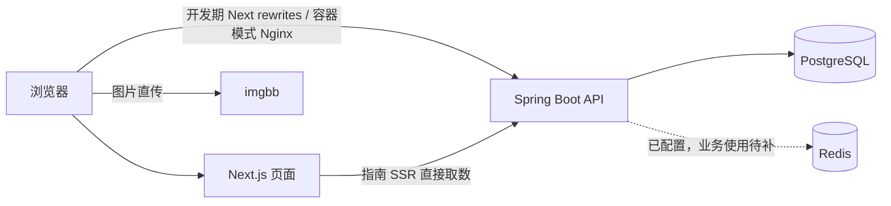

# 项目概览

核查日期：2026-11-09。依据：仓库源码、构建配置和现有 v0.3 需求文档。

## 这是一个什么项目

“装修记录”是面向业主的轻量装修过程与花销记录 Web 应用。一套房对应一个项目，围绕“创建项目 → 管理阶段和检查项 → 记录采购花销/照片 → 查看预算与进度”组织功能，兼顾移动端现场记录。

核心不是装修交易平台或施工企业 ERP。现有 PRD 的方向是轻量记录台：装修指南作为公开的入门参考，用户项目中的实际阶段允许自定义，两者不强制绑定。

## 范围

| 范围 | 内容 |
| --- | --- |
| 当前 P0 目标 | 注册登录、项目档案、默认 8 阶段及自定义、阶段检查项、花销物品名与金额、照片上传、项目与用户总览、公开装修指南 |
| 后续 P1 | 资料/票据库、待办/到期提醒；阶段检查项已有代码，不等于完整提醒系统已实现 |
| 后续 P2 | 多人协作、Excel/PDF 导出、更多统计报表、完整攻略内容等 |
| 小程序 | 只有占位说明，尚无实际应用实现 |

详细需求以 [PRD](../需求相关/产品需求文档(PRD).md) 与后续明确决策为准；当前交付程度见 [当前状态](02-当前状态.md)。

## 技术与架构

| 部分 | 当前仓库实现 |
| --- | --- |
| 前端 | Next.js 15、React 19、TypeScript、axios；pnpm；App Router，业务页以客户端取数为主，指南使用 SSR |
| 后端 | Spring Boot 4.0.0、Spring Security/JWT、JPA/Hibernate、Bean Validation、Springdoc；Maven；编译 release 21 |
| 运行目标 | JVM 开发运行，另有 GraalVM Native Image 适配与 Docker 构建配置；`.java-version` 为 25 |
| 数据库 | PostgreSQL；Flyway V1/V2/V3 管理表结构与指南种子数据 |
| Redis | 已引入依赖和部署配置；未在现有业务代码中发现概览缓存或限流实现 |
| 图片 | 浏览器压缩后直传 imgbb，再把 URL 回传后端保存 |
| 交付 | 前端、后端 JVM/Native Dockerfile；GitHub Actions 构建并推送 GHCR；Docker Compose 与 Nginx 编排 |

该图描述代码/编排设计，不代表当前线上已按此运行。

## 重要既有约定

- JWT 有效期 2 小时，不引入 refresh token；退出由前端清除本地 token 实现。
- 新项目默认初始化：拆改、水电、泥瓦、木工、油漆、安装、软装、验收；阶段预算默认 0。
- 阶段子项无金额，与采购花销分开建模。
- 金额后端使用 BigDecimal，数据库使用 NUMERIC；前端仍使用 JavaScript number，精度边界需要联调验证。
- 所有用户业务接口应检查资源归属；指南公开访问。实际实现与约定不一致处记入问题台账。
- 本文整理既有方向；未新增产品范围或替用户决定排期。
